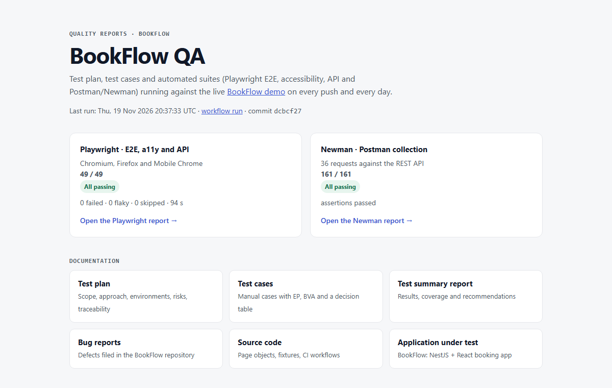
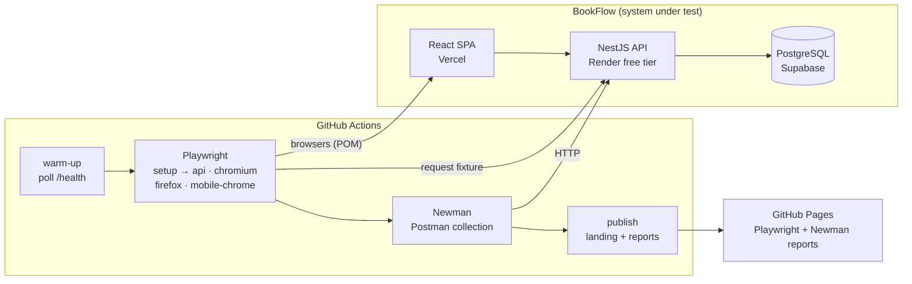

<div align="center">


# BookFlow QA

**End-to-end QA for a real booking app: test plan, 48 test cases, Playwright E2E with the Page Object Model,
API tests with Postman/Newman, accessibility checks and CI reports published every day.**

[](https://github.com/lucaswsanchez/bookflow-qa/actions/workflows/ci.yml)
[](https://github.com/lucaswsanchez/bookflow-qa/actions/workflows/e2e.yml)
[](LICENSE)


### [📊 Live test reports](https://lucaswsanchez.github.io/bookflow-qa/) &nbsp;·&nbsp; [📋 Test plan](docs/test-plan.md) &nbsp;·&nbsp; [🧪 Test cases](docs/test-cases.md) &nbsp;·&nbsp; [🐞 Bug reports](docs/bug-reports.md)

</div>

The application under test is **[BookFlow](https://github.com/lucaswsanchez/bookflow)**, a NestJS + React booking
app for small businesses ([live demo](https://bookflow-phi-ivory.vercel.app),
[Swagger](https://bookflow-api-f8qe.onrender.com/docs)). Everything here runs against that deployed demo.

> ⏳ BookFlow's API runs on Render's free tier: **the first request may take ~50s (free tier cold start)**. The
> pipeline starts with a warm-up step for that reason.



## What's inside

| Deliverable   | Where                                                                 | Highlights                                                                                                                                        |
| ------------- | --------------------------------------------------------------------- | ------------------------------------------------------------------------------------------------------------------------------------------------- |
| Test plan     | [docs/test-plan.md](docs/test-plan.md)                                | Feature map (routes and 32 endpoints), scope, approach, environments, entry/exit criteria, risks, traceability matrix                             |
| Test cases    | [docs/test-cases.md](docs/test-cases.md) · [CSV](docs/test-cases.csv) | 48 cases: functional, negative, boundary and usability, with equivalence partitioning, boundary values and a decision table for slot availability |
| E2E tests     | [tests/e2e](tests/e2e)                                                | 28 Playwright tests with the Page Object Model on Chromium, Firefox and Mobile Chrome                                                             |
| Accessibility | [tests/a11y](tests/a11y)                                              | axe-core WCAG 2.1 A/AA scan of 3 pages, with a baseline of reported issues                                                                        |
| API tests     | [tests/api](tests/api) · [postman](postman)                           | 11 Playwright API tests + a Postman collection of 36 requests and 161 assertions run by Newman                                                    |
| Bugs          | [docs/bug-reports.md](docs/bug-reports.md)                            | 4 real defects filed in the BookFlow repo, plus 6 suggested improvements                                                                          |
| Results       | [docs/test-summary-report.md](docs/test-summary-report.md)            | Totals, coverage by feature, defects by severity, recommendations                                                                                 |
| CI            | [.github/workflows](.github/workflows)                                | Lint on every PR; full suite on push, daily and on demand; reports on GitHub Pages                                                                |

## Features of the test suite

- **Page Object Model:** `BookingPage`, `LoginPage`, `AdminShell`, `ServicesPage` and `AppointmentsPage`. Specs read
  like the test cases, and the test IDs (`TC-BK-01`, …) match the documentation.
- **Role fixture:** `test.use({ role: 'admin' })` opens the browser already logged in, without logging in per test.
- **Session pool:** works around the API's login rate limit (10/min) and rotating refresh tokens. A full run makes
  about 8 logins ([why and how](docs/technical-decisions.md#2-session-pool-instead-of-logging-in-per-test)).
- **Isolated test data on a shared demo:**
  - a booking factory books through the API and cancels in teardown;
  - QA services are created and deleted in the same test;
  - IDs are looked up at runtime.
- **Selectors:** only `data-testid` or accessible roles and labels. There is no `waitForTimeout`: an ESLint rule
  turns it into an error.
- **Known defects as checks:** reported bugs are tracked with `test.fail()` plus a link to the issue, and an
  accessibility baseline. They turn red when a bug is fixed or a new one appears.
- **API contract checks:** status codes, JSON schema, the standard error body and 400/401/403/404/409, including a
  concurrent double-booking test that expects exactly one 201 and one 409.

## Tech stack

| Area                   | Tools                                                                        |
| ---------------------- | ---------------------------------------------------------------------------- |
| E2E and API automation | Playwright 1.65, TypeScript, `@axe-core/playwright`                          |
| API collection         | Postman (Collection v2.1), Newman, newman-reporter-htmlextra                 |
| Quality                | ESLint (typescript-eslint, eslint-plugin-playwright), Prettier, EditorConfig |
| CI/CD                  | GitHub Actions, GitHub Pages                                                 |
| Load (local only)      | k6                                                                           |
| Project management     | GitHub Projects (Kanban), issues, milestones, PRs                            |

## Architecture



```
bookflow-qa/
├── docs/                 test plan, test cases (md + csv), bug reports, summary report, decisions, evidence
├── tests/
│   ├── setup/            auth setup: fills the session pool
│   ├── fixtures/         role, API clients, booking factory (index.ts) · API-only fixtures (api.ts)
│   ├── pages/            page objects
│   ├── support/          env, typed API client, session pool, dates, test data
│   ├── e2e/              booking, auth, permissions, services, appointments, responsive
│   ├── a11y/             axe-core scans
│   └── api/              API tests (request fixture)
├── postman/              collection + live and local environments
├── k6/                   local-only load example
├── site/                 GitHub Pages landing template
├── scripts/              Render warm-up, Pages site builder
└── .github/              CI and E2E workflows, bug report template
```

## Getting started

Requirements: Node.js 20+ and pnpm 9 (`corepack enable`). No `.env` is needed: by default everything points to the
public demo.

```bash
git clone https://github.com/lucaswsanchez/bookflow-qa.git
```

```bash
cd bookflow-qa && pnpm install
```

```bash
pnpm exec playwright install --with-deps chromium firefox
```

### Against a local BookFlow (with or without Docker)

Run BookFlow locally by following [its README](https://github.com/lucaswsanchez/bookflow#getting-started)
(`docker compose up`, or `pnpm dev` with a PostgreSQL database). Then point the suite at it:

```bash
cp .env.example .env
```

In `.env`, set `WEB_URL=http://localhost:5173` and `API_URL=http://localhost:3000`. For Newman use
`pnpm newman:local`.

## Environment variables

| Variable                         | Default                                  | Description                                        |
| -------------------------------- | ---------------------------------------- | -------------------------------------------------- |
| `WEB_URL`                        | `https://bookflow-phi-ivory.vercel.app`  | Web app under test                                 |
| `API_URL`                        | `https://bookflow-api-f8qe.onrender.com` | API under test                                     |
| `BUSINESS_SLUG`                  | `barberia-costanera`                     | Demo business                                      |
| `ADMIN_EMAIL` / `ADMIN_PASSWORD` | `admin@demo.com` / `Admin123!`           | Public demo admin (published in BookFlow's README) |
| `STAFF_EMAIL` / `STAFF_PASSWORD` | `staff@demo.com` / `Staff123!`           | Public demo staff user                             |

No secrets are needed: the only credentials are BookFlow's public demo accounts.

## Running tests

| Command                                              | What it does                                                                   |
| ---------------------------------------------------- | ------------------------------------------------------------------------------ |
| `pnpm warmup`                                        | Waits until the Render API answers `/health`                                   |
| `pnpm test`                                          | Full Playwright run: setup, API, Chromium, Firefox and Mobile Chrome           |
| `pnpm test:chromium`                                 | Chromium project only (E2E and accessibility)                                  |
| `pnpm test:api`                                      | Playwright API tests only                                                      |
| `pnpm exec playwright test --grep @smoke`            | Smoke subset                                                                   |
| `pnpm test:ui`                                       | Playwright UI mode                                                             |
| `pnpm report`                                        | Opens the last HTML report (`reports/playwright`)                              |
| `pnpm newman`                                        | Runs the Postman collection against the live demo (report in `reports/newman`) |
| `pnpm lint` · `pnpm format:check` · `pnpm typecheck` | Static checks (the same as CI on every PR)                                     |

The suite is also importable into Postman: `postman/bookflow.postman_collection.json` + `postman/live.postman_environment.json`.

## Project management

The work was planned and tracked on a **[GitHub Project (Kanban: Backlog / In progress / Done)](https://github.com/users/lucaswsanchez/projects/5)**:

- **9 user stories** as issues, each with acceptance criteria as a checklist and labels (`test`, `docs`, `ci`, `feature`);
- grouped in two milestones, **MVP** and **Polish**;
- one feature branch and one Pull Request per story (`Closes #N`), squash-merged after CI passed;
- Conventional Commits (`test:`, `docs:`, `ci:`, `fix:`);
- defects filed in the application's repository with a [bug report template](.github/ISSUE_TEMPLATE/bug_report.md),
  severity and priority, then linked from [bug-reports.md](docs/bug-reports.md).

The same structure maps directly to **Jira**:

| Jira               | Here                                                                                          |
| ------------------ | --------------------------------------------------------------------------------------------- |
| Epic               | Milestone (MVP, Polish)                                                                       |
| Story              | User story issue with acceptance criteria                                                     |
| Test (Xray/Zephyr) | Test case `TC-*` in [test-cases.csv](docs/test-cases.csv) (importable) and its automated test |
| Bug                | Issue in the BookFlow repo, linked to the failing test case                                   |

## Roadmap

- [ ] Re-run and close the defects once fixed in BookFlow (remove the `test.fail()` annotations and the a11y baseline).
- [ ] UI tests for staff and clients CRUD, the agenda views and reports.
- [ ] Visual regression snapshots of the booking page.
- [ ] Rate-limit (429) test against a local or dedicated QA environment.
- [ ] Publish results to a test management tool (Xray or TestRail import from the CSV/JUnit output).

## Lessons learned / technical decisions

Summary; full reasoning in [docs/technical-decisions.md](docs/technical-decisions.md).

1. **Read the system's constraints before automating.** The login rate limit and rotating refresh tokens ruled out
   both "log in per test" and a static `storageState`, which led to a session pool.
2. **Parallelism finds bugs in the test framework too.** The first CI run with 3 workers deadlocked on the session
   pool. Sharing access tokens for API clients fixed it.
3. **A shared demo needs a data policy.** QA prefixes, far-future dates, cleanup in teardown and one professional
   per browser project keep runs independent and the demo clean for visitors.
4. **Known bugs should be executable.** `test.fail()` with a link to the issue, plus an accessibility baseline,
   keep the pipeline green without hiding the defects.
5. **Explore first, then automate.** Three of the four defects came from an exploratory session of boundary and
   partition checks on the API, before any E2E test existed; the fourth came from the axe scan. Automation then
   locked them in as regression checks.

## Author

**Lucas Sanchez**, Systems Analyst, Corrientes, Argentina.
[LinkedIn](https://www.linkedin.com/in/lucaswsanchez) · [GitHub](https://github.com/lucaswsanchez)

Licensed under the [MIT License](LICENSE).
